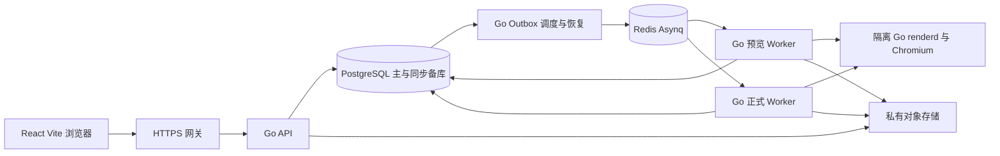
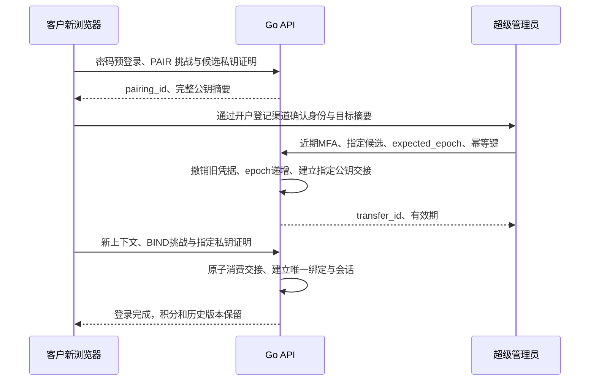

# 单据系统开发落地设计文档

版本：v1.4　日期：2026-11-04　技术栈：Go + React + Vite　交付格式：Markdown

本文用于开发交接：规定首版做什么、代码如何划分、数据怎样保存、接口如何收发、核心事务怎么实现，以及每个阶段怎样验收。它承接 v1.3 已修订的 F01—F10，不把“可开始开发”写成“系统已经实现或可以直接上线”。本文中的路由、类型、迁移名、配置名和构建入口是需要开发落地的契约，目前工作区只有 HTML 原型和设计资料。

同一主题以本文的明确实现约定为开发入口，v1.3 的 53 项验收和安全不变条件继续有效；本文不得用于放宽账号隔离、积分一致性、指定公钥交接或免费预览水印。旧文档和 HTML 保留，不覆盖。所有默认值均可版本化配置，改变配置必须重新验证受影响的边界。

## 1 首版范围与确定的业务规则

首版是单运营方在线 SaaS，管理员人工开户、人工发积分，客户使用浏览器编辑、预览和下载。包括单张生成、商品预设和受容量约束的批量导入，不做在线支付、自助注册、代理分账、组织共享和离线授权。

| 编号 | 业务规则 | 首版实现 |
| --- | --- | --- |
| R01 | 超级管理员与普通用户 | SUPERADMIN、USER 两角色，权限由 Go 服务决定 |
| R02 | 管理员新增用户、增加积分 | 专用管理接口，原因、近期 MFA 和审计 |
| R03 | 新用户积分初始化 0 | 开户事务同时创建 available=0、frozen=0 钱包 |
| R04 | 管理员免积分 | 订单成本 0；不伪造大余额，仍受身份和资源限制 |
| R05 | 每份成功新版本扣 1 分 | 先预留，两个正式格式成功后一起确认消费 |
| R06 | 同版本重复下载免费 | PDF、PNG 共用一次计费，余额 0 也能重下 |
| R07 | 修改后生成新版本再扣 | 草稿免费；不可变版本只在确认生成时建立 |
| R08 | 填写与预览免费 | 免费不等于无限资源，执行配额和队列限制 |
| R09 | 单价、数量手填，税率固定 16% | 服务端定点计算小计、税额、总额和金额文字 |
| R10 | 预览水印不能通过控制台删除取得原图 | 水印合进服务端位图，浏览器没有免费原图 |
| R11 | 正式下载没有预览水印 | 已结算版本独立生成的无水印 PDF、PNG |
| R12 | 纯网页设备限制 | 一账号一浏览器公钥、一有效会话；换机批准指定新公钥 |
| R13 | Go 后端、React + Vite 前端 | 业务单体、隔离渲染服务，不引入第二套业务后端 |

为避免开发时反复作产品决定，首版默认：普通用户关闭手动金额覆盖；零金额正式版本允许但仍消费 1 分；管理员 MFA + 单会话，不强制客户设备绑定；普通业务接口始终只读写本人单据，首版不开放管理员跨用户查看票面内容；正式版本、原文件、历史渲染依赖和财务去重记录在服务有效期内保留。停用用户不能访问，但不删除其历史权益。

设备密钥属于浏览器用户配置，不是物理电脑硬件码。客户已接受纯网页限制；完整浏览器环境复制、同源代签和远程使用不能被绝对阻止。像素水印也不能阻止图像修复或已购文件转发。产品界面使用“绑定浏览器设备，换机需联系管理员”，不宣传绝对防破解。

本系统首版定位为排版和导出，不执行真实税务认证签发。原模板固定二维码、签章及认证编号在生产模板中移除或换成合法资产；用户填写的认证显示时间不代表实际认证结果。

## 2 技术选型与版本策略

| 层 | 选型 | 开发约定 |
| --- | --- | --- |
| 前端 | React 19.3、TypeScript、Vite 8.3 | react 与 react-dom 同版；补丁写入锁文件，不使用发布时浮动 latest |
| 前端运行工具 | Node.js 24 LTS、pnpm | Node 只用于开发构建，具体受支持补丁和 pnpm 版本进工具链清单 |
| UI 与状态 | Ant Design、React Router、TanStack Query | 各选择兼容稳定版；表单、路由、服务端缓存分工明确 |
| HTTP | Go 1.27 系列 + net/http ServeMux | 初始按已核对受支持补丁建工程，发布前核对漏洞和补丁 |
| 数据库 | PostgreSQL 17、pgx/v5、sqlc | SQL 显式，事务绑定同一连接，不用 ORM 隐式事务 |
| 队列 | Redis + Asynq + PostgreSQL outbox | Redis 不是计费事实来源；队列允许重复消息 |
| 渲染 | Go renderd、chromedp、固定 Chromium 与字体 | 隔离无业务凭证，无外网；按 manifest 固定可运行依赖 |
| 图像 | Go image/draw、image/jpeg | 水印服务端合成后重新编码 |
| 文件 | 私有 S3 兼容对象存储 | 不可覆盖写入及精确对象版本语义须验证 |
| 签名 | RFC 9421、Web Crypto P-256、Go httpsig 适配 | 只开放固定算法和组件；禁止自动降级 |
| 交付 | Linux 容器、同源 HTTPS 反向代理 | 前端部署 dist，迁移由流水线单次运行 |

React、Vite、Node 与 Go 的版本状态已按本轮官方资料核对；这是选型基线，不代表本机已经安装这些版本。React 当前文档标示 19.3，Vite 8.3 为受常规维护分支，Node 24 仍为 LTS。参见 [React 版本](https://react.dev/versions)、[Vite 发布策略](https://v8.vite.dev/releases)、[Node 发布状态](https://nodejs.org/en/about/previous-releases)、[Go 发布记录](https://go.dev/doc/devel/release)。

Go 端选用 github.com/dadrus/httpsig 包装标准 HTTP 签名验证；作者文档提供所需组件和 nonce 校验配置，P-256 实现采用 r、s 定长拼接。实施时锁定审查过的 tag 或 commit，完成浏览器互通后写入 go.sum，不因存在该库就省略应用策略检查。参见 [作者仓库](https://github.com/dadrus/httpsig)、[P-256 实现](https://github.com/dadrus/httpsig/blob/main/asymmetric.go)。

浏览器端使用一个固定 RFC profile 的协议适配器封装规范化与 Web Crypto 签名，不能把依赖 Node 私钥导出的包直接搬入 Vite。适配器必须通过 RFC 测试向量和 Go 验证端交叉检查；这属于 W00 的首批验证，不自创签名格式或密码算法。

## 3 部署单元与信任边界



| 单元 | 可持有的权限／凭证 | 不能做的事 |
| --- | --- | --- |
| 浏览器 | 本站不可导出设备私钥、HttpOnly 会话 Cookie | 决定余额、角色、文件用途，获取免费无水印原图 |
| API | 业务 DB、下载读取、身份密钥服务 | 直接运行用户提供的 HTML、URL、模板或路径 |
| outbox | outbox、任务恢复、容量规划、队列、耐久探针与交付回执 | 根据队列错误直接退款，重新生成业务操作 ID |
| trusted worker | 指定任务 DB、对象上传、renderd 调用 | 让旧 lease 发布，覆盖正式对象，绕过 credit service |
| renderd | 可信模板／字体只读包、内部 mTLS 身份 | 访问 DB、Redis、对象存储或云元数据；持有业务密码 |
| GC | 对象候选状态及受控删除 | 删除 PUBLISHED 或仍有读租约的对象 |

renderd 与 trusted worker 分容器。Chromium 不继承 worker 的环境变量或文件挂载；renderd 内部 HTTP 仅接受 mTLS 的 worker 请求，CDP 仅绑定容器回环地址。renderd 出网默认拒绝，加载内置模板及受控数据，字体打包成受控本地资源；不从客户端请求 URL。用户文字经 html/template 转义，不转换 template.HTML。

初期进程为 api、outbox、worker --queue=preview、worker --queue=formal、renderd 和受保护 admin CLI。worker 可使用同一业务构建产物；renderd 为单独无凭证镜像。不是六个业务微服务，账号、积分、单据状态仍是同一 Go 单体与同一数据库事务模型。

## 4 工程结构与模块接口

```text
invoice-system/
  frontend/src/app/                  路由、Provider、认证状态
  frontend/src/features/auth/        登录、MFA、初始化、设备交接
  frontend/src/features/editor/      表单、试算、水印预览、生成确认
  frontend/src/features/documents/   列表、版本、任务、下载
  frontend/src/features/admin/       开户、加分、停用、指定设备交接
  frontend/src/shared/api/           生成类型、apiClient、signedFetch
  frontend/src/shared/device/        CryptoKey、RFC profile、JWK 摘要
  backend/cmd/api/                    HTTP 入口
  backend/cmd/outbox/                 投递、恢复、配额回收、GC 调度
  backend/cmd/worker/                 trusted worker
  backend/cmd/renderd/                无业务凭证的渲染入口
  backend/cmd/admin/                  超管初始化、受保护应急恢复
  backend/internal/account/          密码、预登录、会话、MFA
  backend/internal/device/           配对、交接、nonce、验签策略
  backend/internal/credit/           钱包、账本、幂等结算
  backend/internal/document/         草稿、金额、快照、profile
  backend/internal/generation/       订单、租约、容量票、恢复
  backend/internal/artifact/         对象发布、下载读租约、免费修复
  backend/internal/render/           模板、chromedp、像素水印
  backend/internal/platform/         DB、Redis、存储、密钥配置
  backend/db/migrations/             有序 SQL migration
  backend/db/queries/                sqlc 查询
  backend/internal/dbgen/            sqlc 输出，不手改
  api/openapi.yaml                    实施时提交的接口唯一契约
  private-templates/                  不进入 frontend/public 的模板资产
  deploy/                            镜像、网关、运维配置
  tests/integration/                  真 PostgreSQL、存储和队列测试
  tests/e2e/                          浏览器验收
```

模块之间通过 service 调用，不让 handler 自己修改钱包。以下是业务接口契约，具体 Go 类型由同名领域对象实现，接口方法不等于当前已有代码：

```text
AccountService.CreateUser(actor, input, idemKey) -> user + setupLink
DeviceService.ApproveTransfer(actor, targetUser, pairing, expectedEpoch, idemKey)
CreditService.Grant(actor, targetUser, amount, reason, idemKey) -> operation
DocumentService.Save(actor, documentId, expectedRevision, fields) -> draft
PreviewService.Request(actor, documentId, expectedRevision) -> preview
GenerationService.Create(actor, documentId, confirmation, idemKey) -> order
GenerationService.Complete(jobLease, immutableObjects) -> completedVersion
GenerationService.Release(jobLease, terminalReason) -> failedReleasedOrder
ArtifactService.OpenDownload(actor, versionId, format) -> stream + readLease
ArtifactService.Repair(versionId) -> repairJob
```

handler 做大小／结构校验，service 做授权与事务，repository 只执行参数化 SQL。所有多步写操作由 service 提供一个 UnitOfWork，把 pgx.Tx 传给 sqlc WithTx。HTTP、worker 和 CLI 共用相同业务规则；补偿通过新操作记录，不通过通用后台编辑余额。

## 5 数据模型与迁移交付

### 5.1 公共字段与类型

主键使用服务端 UUID。所有业务时间为 TIMESTAMPTZ，存 UTC；对外 ISO8601。枚举使用 TEXT + CHECK，便于有序迁移。积分、金额分和数量百万分位用 BIGINT；JSON 中一律为十进制字符串。普通计数、revision 和 epoch 限定为 32 位正整数，避免前后端精度分歧；版本回退不递减。未标可空的核心业务字段必须 NOT NULL；初始化阶段未产生的数据由明确状态与相应可空列表示，不用空字符串伪造有效外键。普通字段 Unicode 字符计数用 code point，前后端规则一致；单行字段禁止控制字符和显式双向覆盖控制符。

表默认带 created_at；可修改状态带 updated_at；不可变快照、ledger、manifest 不允许应用角色 UPDATE／DELETE 内容。下面字段字典与约束是建表输入，不把本文件称为已经执行的 migration。

### 5.2 身份与设备表

| 表 | 业务字段与类型 | 约束与索引 |
| --- | --- | --- |
| users | id UUID；username TEXT；role TEXT；is_active BOOL；onboarding_state TEXT；customer_verification_ref TEXT；auth_version INT；binding_epoch INT；device_state TEXT；recovery_state TEXT | username trim 后转 ASCII 小写，格式 [a-z0-9][a-z0-9._-]{2,63} 且唯一；role USER/SUPERADMIN；onboarding 为 NEEDS_SETUP/ENROLLMENT_REQUIRED/READY；device_state 为 NOT_REQUIRED/INITIAL_PENDING/ACTIVE/RESET_PENDING；recovery_state 为 NORMAL/RECOVERY_HOLD |
| password_credentials | user_id UUID；password_phc TEXT；version INT | user_id 主键；PHC 含 Argon2id 参数与随机盐；不保存明文 |
| password_tokens | token_hash BYTEA；user_id UUID；purpose TEXT；auth_version INT；expires_at；used_at | hash 唯一；INITIAL_SETUP/PASSWORD_RESET/ADMIN_BOOTSTRAP 分用途 |
| auth_pre_sessions | token_hash BYTEA；user_id；purpose；auth_version；binding_epoch；expires_at；used_at | 只用于对应认证阶段，5 分钟有效，不能访问业务 |
| device_bindings | id；user_id；public_jwk JSONB；key_thumbprint TEXT；epoch INT；status TEXT | 每账号最多一个 ACTIVE；只接受 P-256 公钥，无 d 私钥字段 |
| device_pairings | id；user_id；public_jwk；key_thumbprint；proof_verified BOOL；expires_at | 仅候选，不自动授权；15 分钟过期，每账号最多 3 个有效候选 |
| binding_transfers | id；user_id；pairing_id；target_key_hash；target_epoch；purpose；status；approved_by；verification_ref；expires_at | 每账号最多一个 PENDING；purpose INITIAL/RESET；RESET 10 分钟，原子单次消费 |
| device_sessions | id；user_id；token_hash；binding_id 可空；generation UUID；auth_version；binding_epoch；factor_version；mfa_verified_at；last_active_at；expires_at；status | 每账号一个 ACTIVE；USER binding_id 必填；管理员无绑定时仍须 MFA |
| device_challenges | id；nonce_hash；purpose；subject_id；key_hash；auth_version；epoch；generation；expires_at；used_at | nonce_hash 唯一；用途 INITIAL_SETUP/PAIR/BIND/LOGIN/REQUEST，不跨主体与用途 |
| mfa_factors | id；user_id；state；seed_ciphertext；factor_version；last_accepted_step BIGINT | NONE/ENROLLING/VERIFIED；每用户一个 VERIFIED；时间步原子去重 |
| mfa_challenges | id；user_id；context_id；purpose；factor_version；expires_at；used_at | 绑定预登录或正式会话及用途，不能跨会话复用 |
| mfa_recovery_codes | id；factor_id；code_hash；used_at | 随机至少 128 位；hash 唯一；消费与会话创建同事务 |

### 5.3 单据与渲染依赖表

| 表 | 业务字段与类型 | 约束与索引 |
| --- | --- | --- |
| render_profiles | id；name；manifest JSONB；manifest_hash；status | ACTIVE/REVOKED；内容不可变；含模板、字体、算法、纸张、时区、兼容 renderer |
| documents | id；owner_id；draft_json JSONB；revision INT；render_profile_id；title TEXT | 索引 owner_id,created_at,id；只有本人可改；profile 变更也是新 revision |
| preview_requests | id；owner_id；document_id；revision；profile_id；content_hash；state；manifest_id；expires_at | 同内容合并；每账号最多一个运行和一个最新等待预览 |
| preview_manifests | id；owner_id；document_id；revision；profile_id；canonical_bytes BYTEA；content_hash；amounts JSONB；expires_at | 一旦成功不可改；确认有效期 10 分钟，订单引用后转历史保留 |
| document_versions | id；document_id；owner_id；version_no INT；source_revision INT；manifest_id；renderer_manifest_id；snapshot_json；unit_cents；qty_micros；subtotal_cents；tax_cents；total_cents | document_id+source_revision 唯一，document_id+version_no 唯一；金额与 JSON 同源生成，不允许再编辑 |
| renderer_manifests | id；image_digest；asset_hashes JSONB；algorithm_versions JSONB；locale；page_settings JSONB；archive_ref | 被历史权益引用即不可清理；archive_ref 只在服务端使用 |
| product_presets | id；owner_id；name；fields_json | owner_id+name 唯一；只允许用户可填字段 |
| batches | id；owner_id；state；expected_count；request_hash | 行数 1—100；状态由行订单聚合，不作为结算依据 |
| batch_drafts | id；owner_id；row_document_ids JSONB；source_hash | 导入幂等资源，按行持久化草稿；不是计费订单 |
| batch_items | id；batch_id；row_no INT；document_id；version_id；order_id | batch_id+row_no 唯一；每行对应独立订单 |

### 5.4 积分、任务与对象表

| 表 | 业务字段与类型 | 约束与索引 |
| --- | --- | --- |
| credit_accounts | user_id；available BIGINT；frozen BIGINT | 默认均 0，非负；API 返回字符串 |
| credit_entries | id；account_id；kind；delta_available；delta_frozen；before_available；after_available；before_frozen；after_frozen；operation_id；related_operation_id 可空；actor_id；reason | GRANT/RESERVE/CONSUME/RELEASE/ADJUST；operation_id+kind 唯一，仅追加；ADJUST 仅经已批准恢复工单调用 |
| idempotency_records | id；actor_id；operation；key_hash；request_hash；resource_id；result_json；status | actor_id+operation+key_hash 唯一；已受理财务操作去重与账本同寿命 |
| generation_orders | id；version_id；owner_id；cost_points SMALLINT；billing_state；reserve_attempt INT；deadline | version_id 唯一；cost 0/1；RESERVED/COMPLETED/FAILED_RELEASED |
| render_jobs | id；kind；order_id 可空；version_id；state；reserve_attempt；attempt_no；lease_token；lease_until；next_attempt_at | GENERATE 对 order_id 唯一；REPAIR 不关联付费 order；同版本仅一个活动 REPAIR |
| scheduler_lanes | id；queue_name；enabled；booked_until；plan_version | 初期 formal 1 槽；规划与领取在 lane 锁下协调，不超卖 |
| capacity_tickets | id；lane_id；owner_id；job_id；slot_start；slot_end；deadline；status；plan_version | start<end；job_id 唯一；同 lane 的有效时间区间不得重叠 |
| artifact_objects | id；owner_id；version_id/preview_id 二选一；type；reserve_attempt；attempt_no；storage_key；object_version；sha256；size；state；protected_until | key 唯一且不可覆盖；UPLOADING/READY/PUBLISHED/RETIRED/GC_CLAIMED/DELETED |
| artifacts | id；version_id/preview_id 二选一；type；current_object_id | 每版本每 CLEAN_PDF/CLEAN_PNG 一个引用；用途及 owner 与对象一致 |
| artifact_read_leases | id；object_id；lease_until | 下载建立有界读租约，GC 持对象锁检查；崩溃后到期回收 |
| outbox_events | id；event_type；aggregate_id；payload JSONB；status；attempts；next_attempt_at | 与业务同事务写入；事件重复不重复结算 |
| audit_logs | id；actor_id；action；target_type；target_id；request_id；redacted_meta JSONB | 按 actor、target、时间检索；不存秘密或完整票面 |
| recovery_cases | id；incident_id；account_id；operation_id；evidence_refs JSONB；status；approved_by | incident_id+operation_id 唯一；关联补偿新流水，不改旧账本 |

### 5.5 核心 SQL 约束

以下片段必须进入相应 migration。外键同时校验版本、所有者和用途；不能仅依赖前端，也不能只在查询前检查唯一性。

```sql
CREATE UNIQUE INDEX uq_binding_active ON device_bindings(user_id)
  WHERE status = 'ACTIVE';
CREATE UNIQUE INDEX uq_session_active ON device_sessions(user_id)
  WHERE status = 'ACTIVE';
CREATE UNIQUE INDEX uq_transfer_pending ON binding_transfers(user_id)
  WHERE status = 'PENDING';
CREATE UNIQUE INDEX uq_factor_verified ON mfa_factors(user_id)
  WHERE state = 'VERIFIED';
ALTER TABLE credit_accounts ADD CONSTRAINT ck_wallet_nonnegative
  CHECK (available >= 0 AND frozen >= 0);
CREATE UNIQUE INDEX uq_ledger_operation ON credit_entries(operation_id, kind);
CREATE UNIQUE INDEX uq_idem ON idempotency_records(actor_id, operation, key_hash);
CREATE UNIQUE INDEX uq_version_revision ON document_versions(document_id, source_revision);
CREATE UNIQUE INDEX uq_version_number ON document_versions(document_id, version_no);
CREATE UNIQUE INDEX uq_order_version ON generation_orders(version_id);
CREATE UNIQUE INDEX uq_job_order ON render_jobs(order_id) WHERE kind = 'GENERATE';
CREATE UNIQUE INDEX uq_repair_active ON render_jobs(version_id)
  WHERE kind = 'REPAIR' AND state IN ('QUEUED','RUNNING','RETRY_WAIT');
CREATE UNIQUE INDEX uq_object_key ON artifact_objects(storage_key);
CREATE UNIQUE INDEX uq_final_format ON artifacts(version_id, type)
  WHERE type IN ('CLEAN_PDF','CLEAN_PNG');
ALTER TABLE generation_orders ADD CONSTRAINT ck_cost CHECK (cost_points IN (0,1));
ALTER TABLE document_versions ADD CONSTRAINT ck_totals CHECK (
  unit_cents >= 0 AND qty_micros >= 0 AND subtotal_cents >= 0
  AND tax_cents = (subtotal_cents * 16 + 50) / 100
  AND total_cents = subtotal_cents + tax_cents
  AND total_cents <= 99999999999
);
```

容量区间由单 lane 行锁串行规划，并用集成测试证明无重叠；若改为多规划器直写，需增加适用的数据库排斥约束，不能移除串行规则而只保留注释。账本仅 INSERT 的权限由 migration 单独 REVOKE/GRANT；迁移角色与应用角色分开。

### 5.6 迁移分组

| 文件编号 | 内容 | 依赖及完成条件 |
| --- | --- | --- |
| 001_identity | users、密码与用途令牌、预登录 | 账号唯一、停用／auth_version 生效 |
| 002_device_session | 设备、公钥、交接、nonce、会话 | ACTIVE/PENDING 唯一、用途与 epoch 校验 |
| 003_mfa | 因子、挑战、恢复码 | TOTP 与恢复码原子单次消费 |
| 004_credit | 钱包、流水、幂等 | 0 初始化、非负、去重、禁止改历史 |
| 005_document | profile、草稿、预设、preview manifest | revision 与 profile 固定，字段 schema 版本化 |
| 006_generation | versions、orders、jobs、outbox | 版本／订单唯一、事务与恢复条件可测 |
| 007_capacity | lanes、tickets、batch_drafts、批量 | 原子准入、每用户限制、不超卖 |
| 008_artifact | objects、发布引用、读租约、durability_probes、delivery_receipts | 不可变发布、明确同步确认后可下载、GC 排他与免费修复 |
| 009_archive_audit | renderer 归档、审计、恢复工单 | 历史依赖可追溯、补偿幂等 |

依赖环通过在后续迁移补外键解决，不能为顺序方便永久不建外键。生产迁移只做兼容新增，回滚程序不自动执行删表 down；清理旧字段需另行确认保留和恢复策略。

## 6 票面字段与金额实现

首版保留原型的一行商品结构。字段由 Form 管理，票面只显示服务端水印图片，不在完整无水印画布上覆盖透明输入框。

| 字段 | 输入约束 | 写入方 |
| --- | --- | --- |
| recipient_name | 非空，最多 160 字符，单行 | 用户 |
| product_code | 非空，最多 32 字符，单行 | 用户 |
| quantity | 非负十进制字符串，整数最多 9 位，小数最多 6 位 | 用户 |
| unit_code | 非空，最多 32 字符 | 用户 |
| unit_description | 最多 2 行，每行 40 字符 | 用户 |
| description | 非空，最多 240 字符，单行 | 用户 |
| issued_at | 含偏移的 RFC3339 时间；后端归一化 UTC | 用户 |
| certification_display_at | 可空，含偏移的 RFC3339，仅为票面显示 | 用户 |
| unit_price | 非负十进制字符串，整数最多 9 位，小数最多 2 位 | 用户 |
| line_amount、subtotal | 两位小数字符串，当前单行时相同 | 服务端 |
| tax_label、tax_amount | 固定 IVA 16%，根据小计计算 | 服务端 |
| total、tax_detail、total_words | 根据正式金额和固定算法生成 | 服务端 |

单价／数量只接受 ASCII 数字与点，不接收指数、NaN、Infinity、负数、千分位或货币符号。前端可用字符串规则规范化 `$1,234.56`，不能经 Number/parseFloat 再提交。金额例：输入 `100`，后端规范为 `100.00`；数量以整数百万分位保存和比较。规范化序列化版本写入 content_hash，内容相同不增加 revision。

计算固定如下；中间乘法用 big.Int，范围确认后才转 int64：

```text
unit_cents = 十进制单价 × 100
qty_micros = 十进制数量 × 1000000
subtotal_cents = (unit_cents × qty_micros + 500000) 整除 1000000
tax_cents = (subtotal_cents × 16 + 50) 整除 100
total_cents = subtotal_cents + tax_cents
0 <= total_cents <= 99999999999
```

该算法是非负数 HALF_UP，先舍入小计再算税额。100 × 5 为 500.00、80.00、580.00；86.21 × 5 为 431.05、68.97、500.02。不能为贴合原票据 500.00 而偷偷调整税额或小计。西班牙语金额文字由同一 total_cents 产生，规则版本固定；首个模板显示时区采用 America/Mexico_City，用户在预览确认转换后的日期。

纸张沿用原型 569.52 × 737.28 pt，逻辑尺寸 1582 × 2048，0.36 pt/逻辑像素。主要字段至少 8 pt，辅助字段至少 6 pt，超长字段不能满足时返回 TEXT_DOES_NOT_FIT 并标字段，不截断或无限缩字。2 倍 PNG 为 3164 × 4096；PDF 单页、零外边距、100% 纸面验收。改变纸张、字体或时区需新 profile。

## 7 API 统一约定与 DTO

### 7.1 HTTP 与认证级别

前缀统一 `/api/v1`。同源 HTTPS，写操作 JSON + X-CSRF-Token。所有 DTO 拒绝未知敏感字段、重复键和尾随第二个 JSON 值；Body 默认上限 64 KiB，批量 1 MiB，验签读取前使用 MaxBytesReader 限制。正文签名前序列化一次，摘要与发送字节相同。

| 标记 | 要求 |
| --- | --- |
| A | 匿名认证入口，只能处理自身认证流程；写请求仍校验 Origin、CSRF 与限速 |
| T | 目的匹配的单次设置／bootstrap 授权，不能替代业务会话 |
| P | 有效预登录上下文；仅密码验证、设备证明和既有 MFA 等受限流程 |
| C | 有效业务 Cookie，仅可查询最小设备上下文；无业务数据 |
| B | 完整业务认证；USER 必须有效 Cookie + ACTIVE 设备签名，SUPERADMIN 必须完整 MFA 会话；只访问本人资源 |
| M | SUPERADMIN 完整 MFA 会话，只能访问已明确的管理数据 |
| MF | M 加 5 分钟内近期 MFA，并在事务锁内复查操作者权限 |

Idempotency-Key 采用客户端为一次明确动作生成的 UUID；网络重试沿用原键，每次签名 nonce 必须新领。服务端按 actor_id、operation、key_hash 唯一，绑定规范化参数和资源 ID。键不是凭证，返回旧结果前仍鉴权。同键不同参数 409。新建用户、发分、交接、生成、批量和新建批量草稿必须幂等；保存草稿以 revision 保证并发安全。路由注册时必须声明认证级别，没有声明默认拒绝，不靠页面守卫补权限。预登录与 bootstrap 分别用独立 Secure/HttpOnly 的 __Host-pre-session、__Host-bootstrap Cookie；JSON context_id 仅为签名代号，不能作为独立 bearer 凭据，各阶段 CSRF 绑定相应 Cookie 上下文。

成功响应直接返回对象；错误统一如下。错误码稳定，中文文案可调整，不能依靠 message 分支控制逻辑：

```json
{
  "code": "REVISION_CONFLICT",
  "message": "内容已更新，请重新载入",
  "request_id": "req_example_001",
  "details": { "current_revision": 13 }
}
```

### 7.2 核心请求 DTO

以下 JSON 展示核心字段与示例值；ID 是示例 UUID，不代表真实账号或文件。

```json
{
  "DraftFields": {
    "recipient_name": "CLIENTE EJEMPLO",
    "product_code": "53131620",
    "quantity": "5",
    "unit_code": "DPC",
    "unit_description": "Docenas de piezas",
    "description": "Producto de ejemplo 100 ml",
    "issued_at": "2026-11-04T10:00:00-06:00",
    "certification_display_at": null,
    "unit_price": "100.00"
  },
  "SaveDraftRequest": {
    "expected_revision": 12,
    "fields": {
      "recipient_name": "CLIENTE EJEMPLO",
      "product_code": "53131620",
      "quantity": "5",
      "unit_code": "DPC",
      "unit_description": "Docenas de piezas",
      "description": "Producto de ejemplo 100 ml",
      "issued_at": "2026-11-04T10:00:00-06:00",
      "certification_display_at": null,
      "unit_price": "100.00"
    }
  },
  "GenerateRequest": {
    "expected_revision": 12,
    "accepted_preview_manifest_id": "11111111-1111-4111-8111-111111111111",
    "accepted_cost_points": "1"
  },
  "GrantRequest": { "amount": "100", "reason": "人工确认销售订单后加分" },
  "TransferApprovalRequest": {
    "expected_binding_epoch": 4,
    "pairing_id": "22222222-2222-4222-8222-222222222222",
    "target_key_hash": "xXR1y4uZAnrBfdHaA0auRtdNkmEfm-R2tZdLG7lD6k8",
    "verification_ref": "SUPPORT-EXAMPLE-001",
    "reason": "核验开户联系渠道及目标公钥后换机"
  }
}
```

创建草稿请求为 `{fields: DraftFields}`，由服务端选择当前 profile、owner 和 revision=1。PATCH 是完整替换 fields 的保存操作，不是 JSON Merge Patch；未改变规范化内容时返回原 revision。发分 amount 是正整数字符串，使用整数范围检查并在加法前防溢出。角色、owner_id、cost_points、billing_state、storage_key、watermark 不是客户可写字段。B/M/MF 统一要求 is_active=true、onboarding_state=READY；T 入口还须校验 token 的服务端用途、auth_version 与对应待初始化状态，不能利用过期／撤销授权重新启用账号。

### 7.3 核心响应 DTO

```json
{
  "DraftResponse": {
    "id": "33333333-3333-4333-8333-333333333333",
    "revision": 12,
    "render_profile_id": "44444444-4444-4444-8444-444444444444",
    "amounts": { "subtotal": "500.00", "tax_rate": "0.16", "tax": "80.00", "total": "580.00" },
    "calculation_version": "mxn-iva16-halfup-v1"
  },
  "PreviewReady": {
    "id": "55555555-5555-4555-8555-555555555555",
    "state": "READY",
    "draft_revision": 12,
    "preview_manifest_id": "11111111-1111-4111-8111-111111111111",
    "confirmation_expires_at": "2026-11-04T16:10:00Z",
    "image_path": "/api/v1/previews/55555555-5555-4555-8555-555555555555/image"
  },
  "GenerationResponse": {
    "generation_id": "66666666-6666-4666-8666-666666666666",
    "version_id": "77777777-7777-4777-8777-777777777777",
    "state": "QUEUED",
    "billing_state": "RESERVED",
    "cost_points": "1",
    "available_points": "9",
    "frozen_points": "1",
    "delivery_state": "PENDING",
    "deadline_at": "2026-11-04T16:05:20Z"
  }
}
```

DraftResponse 实际还返回 fields，字段结构与 DraftFields 一致，此处只展示响应新增字段。GenerationResponse 查询完成后仍带相同 ID 和成本；COMPLETED 且 delivery_state=READY 才提供 pdf/png 应用内下载路径；结算后回执尚未就绪时前端显示 FINALIZING。路径不是公开授权，仍须 signedFetch。任何响应不返回对象 key、TOTP seed、密码 hash 或其他人的资源信息。

### 7.4 错误码与恢复动作

| HTTP | code | 前端动作 |
| --- | --- | --- |
| 400 | VALIDATION_ERROR、TEXT_DOES_NOT_FIT | 对应字段提示；停止生成 |
| 401 | SESSION_EXPIRED、SESSION_REPLACED | 清用户缓存与 Blob，重新登录，保留设备密钥 |
| 403 | FORBIDDEN、DEVICE_MISMATCH、DEVICE_PROOF_REQUIRED | 不重试越权；设备不匹配进入人工交接说明 |
| 404 | NOT_FOUND | 不区分不存在与他人资源 |
| 409 | REVISION_CONFLICT | 重新载入或人工合并 |
| 409 | DOCUMENT_HAS_VERSIONS | 提示保留已有版本，不能级联删除 |
| 409 | PREVIEW_STALE、PROFILE_REVOKED | 免费重预览或显式采用新 profile，不扣分 |
| 409 | CREDITS_INSUFFICIENT、COST_CHANGED | 刷新余额／成本，用户重新确认 |
| 409 | IDEMPOTENCY_CONFLICT、GENERATION_IN_PROGRESS | 前者停止；后者恢复原订单 |
| 409 | DEVICE_BINDING_CHANGED、DEVICE_TRANSFER_REQUIRED、DEVICE_TRANSFER_EXPIRED | 获取新认证上下文或联系管理员，不能自动解绑 |
| 409 | BATCH_CAPACITY_EXCEEDED | 减少行数或按 Retry-After 重试；无预留 |
| 409 | ARTIFACT_REPAIRING | 显示修复中，重复查询免费 |
| 429 | RATE_LIMITED、RESOURCE_QUOTA_EXCEEDED | 按 Retry-After 退避，不换 nonce 循环轰炸 |
| 503 | RESULT_PENDING、RECOVERY_HOLD、DEPENDENCY_UNAVAILABLE | 同键查询／重试；不报告扣费失败后再换键 |

nonce 过期或重放使用 400 DEVICE_NONCE_EXPIRED／DEVICE_NONCE_REPLAY，签名错误使用 400 DEVICE_PROOF_INVALID；仅在有效密码上下文或会话后细分，匿名登录统一错误。

## 8 接口清单与页面对应

### 8.1 认证与设备

| 方法 路径 | 认证 | 请求／返回 | 实现要点 |
| --- | --- | --- | --- |
| GET /auth/csrf | A | 返回对应上下文 CSRF token | Cookie Secure、上下文绑定，不返回业务数据 |
| POST /auth/login | A | username,password -> stage,context_id,expires_at | 只建预登录；普通用户转设备验证，超管转 MFA |
| POST /auth/device/challenges | T/P/C | purpose,候选公钥或绑定引用 -> challenge_id,nonce,context_id,proof_key_id,server_time,expires_at | 按用途选定公钥；REQUEST 必须已有正式 Cookie |
| POST /auth/password/set | T | token,new_password,候选公钥及对应 proof -> 初始 transfer_id 与新受限上下文，或重设完成 | INITIAL_SETUP 才有新绑定授权；PASSWORD_RESET 不换绑 |
| POST /auth/device/pairings | P | public_jwk,PAIR proof -> pairing_id,key_thumbprint,expires_at | 候选持钥验证；不返回文件或余额 |
| GET /auth/device/transfers/{id} | P | 返回本人交接最少状态 | 公共编号不是授权，不能查其他用户 |
| POST /auth/device/bind | P | transfer_id,BIND proof -> 建正式会话 | 指定公钥授权，单次领取 |
| POST /auth/device/verify | P | LOGIN proof -> 建正式会话 | 成功后才撤销旧会话 |
| GET /auth/device/context | C | generation,binding_id,server_time | 仅上下文刷新，不能用于读取业务 |
| POST /auth/admin/bootstrap/start | T | bootstrap_token,new_password -> 受限初始化上下文及一次性 seed 展示 | 不是普通密码登录可调用的配置入口 |
| POST /auth/admin/bootstrap/confirm | T | bootstrap_context,totp -> 启用完成 | 原子消费上下文与时间步；完成前无业务会话 |
| POST /auth/mfa/challenges | P 或 M | purpose=LOGIN/STEP_UP/ENROLL_CONFIRM -> challenge_id,expires_at | 绑定已有预登录或会话和因子版本，仅 60 秒有效 |
| POST /auth/mfa/verify | P | challenge_id,totp 或 recovery_code -> 正式会话 | 时间步／恢复码单次 |
| POST /auth/mfa/step-up | M | 新挑战与 TOTP -> recent_verified_at | 只更新当前正式会话的近期验证 |
| POST /auth/mfa/enrollments | MF | 请求新因子 -> enrollment_id,一次性 seed | 暂存新因子，旧因子仍有效 |
| POST /auth/mfa/enrollments/{id}/confirm | MF | 新 TOTP -> 切换完成 | 撤销旧会话、旧恢复码及旧验证 |
| POST /auth/password/change | B，管理员需 MF | old_password,new_password -> 完成 | 撤销会话，不换设备授权 |
| POST /auth/logout | P 或 B | 退出当前上下文 | 正式 USER 会话需设备签名；只撤销本人对应上下文 |

ChallengeRequest 字段为 purpose、可选 public_jwk、可选 transfer_id；INITIAL_SETUP 额外提供 setup_token，其他主体由对应 Cookie 确定，不能传 user_id 指定别人。PasswordSetRequest 为 token、new_password，INITIAL_SETUP 分支还必须提供 public_jwk、challenge_id 和请求签名；PASSWORD_RESET 分支不接受或产生绑定授权。分支以服务端 token 记录的 purpose 为准，不能由客户端自报。BindRequest 为 transfer_id、challenge_id；LoginDeviceRequest 为 challenge_id；MFA 请求为 challenge_id 加 totp 或 recovery_code，二者不能同时提交。

proof 统一使用 HTTP Signature-Input、Signature 及 Content-Digest Header，不另定义正文内的裸字符串签名协议。上述“proof”表示对应 HTTP 请求已按第 10 节验签；challenge_id／transfer_id 放入被摘要覆盖的正文。认证 payload 和 Header 不能进入普通访问日志。

### 8.2 用户业务

| 方法 路径 | 认证 | 请求／返回 | 实现要点 |
| --- | --- | --- | --- |
| GET /me | B | 当前用户、角色、钱包、会话 generation | 余额、角色只作展示，正式写入再次校验 |
| GET /credits/entries | B | cursor,limit -> 本人流水摘要 | 默认 20，上限 100 |
| POST /operations/lookup | B，管理操作另核 M | operation,idempotency_key -> 原操作状态与授权结果 | 超时找回；NOT_FOUND 不证明之前绝不会提交，可同键重试 |
| GET /render-profiles | B | 可选 profile 元数据 | 仅 ID、名称、可用性，不给模板文件和存储 key |
| POST /documents | B | fields -> 草稿 | owner/profile/revision 由服务端写 |
| GET /documents | B | cursor,limit,status -> items,next_cursor | 本人列表，工作台复用 limit=5 |
| GET /documents/{id} | B | 草稿、profile、amounts | 本人；不可直接取得无水印票面 |
| DELETE /documents/{id} | B | expected_revision -> 204 | 仅无任何 version 的本人草稿；锁内与生成互斥，已有版本返回 409 DOCUMENT_HAS_VERSIONS，不级联删权益 |
| PATCH /documents/{id} | B | SaveDraftRequest -> 保存结果 | expected_revision 乐观锁，无变化不递增 |
| POST /documents/{id}/render-profile | B | expected_revision,target_profile_id -> 新 revision | 显式采用新模板，之后重新预览确认 |
| POST /documents/{id}/previews | B | expected_revision -> preview_id,state | 免费，防抖与服务端内容合并 |
| GET /previews/{id} | B | 查询状态；READY 返回 manifest 与图片路径 | owner、revision、profile 匹配 |
| GET /previews/{id}/image | B | JPEG 流 | 只能 PREVIEW 像素，no-store |
| POST /documents/{id}/generations | B | GenerateRequest -> GenerationResponse | 必须 Idempotency-Key，容量／积分／快照同事务 |
| GET /generations/{id} | B | 查询任务与计费状态 | 后端状态权威，不能提交成功标记 |
| GET /documents/{id}/versions | B | 不可变版本列表 | 同版 PDF/PNG 共用权益 |
| GET /versions/{id}/download | B | format=pdf/png -> 文件流 | 只查已完成权益，不检查剩余积分 |
| GET POST /presets | B | 列表／name,fields -> 本人预设 | 创建去重，不能保存只读金额字段 |
| PATCH DELETE /presets/{id} | B | 修改／删除本人预设 | 字段白名单；不影响已生成版本 |
| POST /batch-drafts | B | base_fields,rows -> 各行 document_id,revision | Idempotency-Key，最多 100 行；不冻结积分 |
| POST /batches/estimate | B | document_ids -> 成本、建议行数、最晚预算 | 非承诺估算，不分配容量票 |
| POST /batches | B | 每行 document_id,revision,manifest_id 及总成本 -> batch | Idempotency-Key，整批校验／准入／预留 |
| GET /batches/{id} | B | 各行订单状态与已消费／释放数 | 只返回本人，不按前端统计计费 |

列表固定按 created_at,id 倒序；游标封装 owner、过滤条件、排序版本与边界，使用服务端认证，换过滤条件重开游标。只使用 created_at 排序避免更新导致翻页漂移。空列表返回 items=[]、next_cursor=null；状态变化由刷新展示，不承诺多页查询快照一致。

### 8.3 管理接口

| 方法 路径 | 认证 | 请求／返回 | 实现要点 |
| --- | --- | --- | --- |
| GET /admin/users | M | cursor,username,status -> 用户、余额及绑定摘要 | 不返回密码或完整票面 |
| POST /admin/users | MF | username,客户核验渠道引用,reason -> user,一次性 setup_link | Idempotency-Key；新建 USER 和 0 钱包 |
| PATCH /admin/users/{id}/status | MF | is_active,reason -> 状态 | 撤销会话，停用后任务不能发布 |
| POST /admin/users/{id}/password-reset | MF | reason -> 一次性 reset_link | 不清除绑定，不能重置超管 MFA |
| GET /admin/users/{id}/device-binding | M | 当前绑定、epoch、候选摘要 | 候选仅供核验，不自动选最近一个 |
| POST /admin/users/{id}/device-reset | MF | TransferApprovalRequest -> transfer_id,target_epoch,expires_at | Idempotency-Key；原子批准指定公钥并撤销旧凭据 |
| POST /admin/users/{id}/device-transfers/{transfer_id}/cancel | MF | expected_binding_epoch,reason -> CANCELLED | 不恢复开放密码激活 |
| POST /admin/users/{id}/credit-grants | MF | GrantRequest -> operation_id,新余额 | Idempotency-Key；锁内复查操作者与目标 |
| GET /admin/credit-entries | M | user_id,cursor -> 全局流水 | 审计访问，不返回其他秘密 |
| GET /admin/audit-logs | M | actor/action/time,cursor -> 脱敏事件 | 分页、参数白名单 |

一次性 setup/reset 链接响应丢失时不从审计或业务幂等快照恢复明文 token：旧操作可确认已完成，但管理员需明确重新签发并作废前一凭据；重签操作另有幂等键与审计，不新增账号或积分。链接人工通过开户已登记渠道交付，本设计不自动发送消息。TOTP seed 同样只展示一次，丢失按受保护流程重新启用。

## 9 账号、MFA 与指定设备交接流程

### 9.1 管理员初始化

1. 运营人员在受保护环境执行 admin CLI，创建 ENROLLMENT_REQUIRED 超管和 0 钱包，输出单次 ADMIN_BOOTSTRAP 链接，15 分钟过期，只存 token 哈希。
2. 浏览器 bootstrap/start 验证该授权、Origin 和 CSRF，设置密码并生成暂存 TOTP seed，返回受限初始化上下文和一次性二维码。不能因 role=SUPERADMIN 就建立业务会话。
3. bootstrap/confirm 校验新 TOTP，原子消费上下文、保存已用时间步并置 VERIFIED；完成后才建立完整 MFA 会话，记录因子版本与 mfa_verified_at。
4. 中途过期则保持不可登录，CLI 明确作废旧上下文再重签；普通预登录不能进入 bootstrap。

日常登录为密码 -> MFA -> 唯一正式会话。TOTP 每 30 秒一步，允许前后 1 步，成功时间步必须大于 last_accepted_step；锁内条件更新，多实例同一步只接受一次。恢复码随机至少 128 位、哈希存储、单次消费。因子更换先近期验证旧因子，再确认新因子并撤销旧会话、恢复码及验证时间；因子全丢失走受保护运维恢复，无密码单因素重置公网入口。参见 [RFC 6238](https://www.rfc-editor.org/rfc/rfc6238.html#section-5.2) 与 [OWASP MFA 指南](https://cheatsheetseries.owasp.org/cheatsheets/Multifactor_Authentication_Cheat_Sheet.html)。

### 9.2 客户初次开通

1. 管理员开户，保存客户核验渠道引用，创建 USER、0 钱包及 INITIAL_SETUP 链接；链接经已登记联系渠道人工交付。
2. 浏览器读取 fragment 令牌后立即清除 URL，创建不可导出 P-256 私钥，写入 IndexedDB、重新读取并本地签名自检。失败则停止，不能降级保存明文私钥。
3. 用 INITIAL_SETUP 令牌和候选公钥申请对应挑战，再以该私钥签署 password/set 请求，正文包含挑战引用、设置令牌、新密码和候选公钥。服务端在事务内消费设置令牌、存密码、固定该公钥的 INITIAL 授权，并签发新的受限预登录上下文。
4. 浏览器领取 BIND 挑战，再提交 bind；事务核对授权公钥、epoch、上下文、挑战和无 ACTIVE 绑定，原子消费授权并创建唯一绑定与正式会话。
5. 仅知道新密码却没有该授权公钥私钥的人不能抢先激活。响应丢失可在原设备走正常持钥登录；绑定尚未完成且授权丢失则联系管理员，不自动开放密码激活。

### 9.3 正常登录与会话

USER 密码通过只建立 5 分钟预登录；LOGIN 挑战仅查当前 ACTIVE 公钥，验签后才锁账号并轮换唯一正式会话。异机、错密码和无效签名不能撤销原用户会话。多个标签页共享 Cookie，会话 generation 变化后通过最小 context 端点刷新，再由原私钥签名。

正式 Cookie 使用 __Host-session，至少 256 位随机原令牌，Secure、HttpOnly、SameSite=Lax、Path=/、无 Domain；DB 只存 SHA-256 哈希。USER 只有成功签名请求更新活跃时间；闲置 30 分钟、绝对 8 小时到期。退出清缓存与 Blob，但保留设备 CryptoKey；改密、找回密码不自动清设备绑定。

### 9.4 换机与浏览器密钥丢失



管理员必须通过与账号密码独立的开户登记渠道核验客户和完整公钥摘要，保存 verification_ref。不能选“最新候选”、只核对微信昵称或把正确密码当身份充分证明。未建档或无法核验时不执行交接，进入运营升级处理。

批准事务按全局锁序复查操作者 MF、候选归属与持钥、摘要和 expected_binding_epoch，再撤销旧绑定／会话／授权，递增 auth_version 与 epoch，置 RESET_PENDING，创建只允许指定公钥的 10 分钟交接。客户必须取得新的预登录上下文。取消、过期、错误公钥或旧 epoch 均不能领取；取消后不自动回退到“谁先持密码谁绑定”。已受理任务继续按原订单完成；停用账号则禁止发布并补偿。已开始下载的字节不能追回。

## 10 设备签名固定 profile

首版定义 profile 名 `invoice-device-v1`，只允许 RFC 9421 ecdsa-p256-sha256，HTTP Content-Digest 采用 RFC 9530 sha-256。USER 的业务查询、预览、下载和写操作全部校验；管理员不绑定客户设备，但必须经过完整 MFA 与 CSRF。规范依据：[RFC 9421](https://www.rfc-editor.org/rfc/rfc9421.html)、[RFC 9530](https://www.rfc-editor.org/rfc/rfc9530.html)。

| 项目 | 固定约定 |
| --- | --- |
| 设备公钥 | JWK kty=EC、crv=P-256、x/y 各 32 字节，拒绝 d 和任意算法 |
| 公钥摘要 | RFC 7638 SHA-256 JWK thumbprint，完整 base64url 值用于核验，不只比较短码 |
| 必签组件 | @method、@target-uri、x-device-id、x-session-generation |
| 正文请求 | 另外必须签 content-type、content-digest，原始字节重新算摘要 |
| 幂等写操作 | 另外必须签 idempotency-key |
| 必须参数 | created、expires、nonce、keyid、tag=invoice-device-v1 |
| ECDSA 编码 | Web Crypto 与 RFC P-256 为 64 字节 r、s 定长拼接，不直接交给 VerifyASN1 |
| REQUEST nonce | 服务端生成至少 128 位，绑定主体、generation、epoch、用途；60 秒、单次 |
| 公开 URI | 固定 PUBLIC_ORIGIN + 原始 escaped path + 原始 query；网关保留 /api 前缀，不重排参数、不重写正文 |
| BIND／LOGIN／PAIR | 使用对应受限 context_id 代替正式 generation；公钥从服务端挑战／批准记录查，不由请求自由替换 |

RFC 7638 对 EC 公钥取 crv、kty、x、y 必需成员，按规范求摘要；不能用任意 JWK JSON 字段顺序直接 hash，参见 [RFC 7638](https://www.rfc-editor.org/rfc/rfc7638.html)。用于业务 manifest 的内容 hash 则由 Go 服务端固定 DTO 序列化产生并保存 canonical_bytes，浏览器只引用 ID，不自行声明权威摘要。

REQUEST／LOGIN 的 x-device-id 与 keyid 指向当前绑定 UUID；INITIAL_SETUP／PAIR／BIND 尚无正式绑定时，使用挑战响应返回的随机 proof_key_id，该值在数据库绑定候选公钥摘要和用途。所有请求的 x-session-generation 必须等于当前正式 generation 或受限 context_id，不是客户端任选字符串。SUPERADMIN 的 device_state 初始为 NOT_REQUIRED；USER 初始化完成密码后仍需 INITIAL 授权绑定，只有完整认证后才可业务访问。

验证顺序：限制 Body -> 检查 Origin/CSRF -> 校验 Cookie／受限上下文 -> 查当前公钥与版本 -> 检查必需组件／算法／tag／时限 -> 验签与正文摘要 -> 在共享 DB 条件消费 nonce -> 业务授权。公钥 JWK 请求只发送 kty/crv/x/y 四个成员，浏览器 export 的附加成员不作为输入授权。nonceChecker 必须先确认候选 nonce 的主体和版本，且只在签名有效后消费；若库回调顺序不同，适配层拆为校验和最终消费，不能让无效签名烧掉他人 nonce。

副作用在事务内再次校验账号、会话、epoch、MFA 的当前状态，防止验证后被撤销。验签库默认支持哪些算法不等于本服务全部开放，应用层必须只允许选定 profile。TLS 代理信息只接受配置的网关，不信任客户端 Forwarded 头；拒绝模糊路径和未签名重定向。时钟以服务端 challenge 的 server_time 校准，签名有效期不得晚于 nonce 到期，客户端自报时间不成为授权依据。

前端签名流程为：序列化正文一次 -> 领取新 nonce -> 构造 RFC signature base -> crypto.subtle.sign -> 按 RFC Header 编码 -> fetch 同样字节。Abort 或重试时重新领 nonce、保留业务幂等键。W00 用 GET、JSON POST、带查询下载、正文变化、PATCH/DELETE、参数变化、重放、旧 epoch 和代理经过前后向量验证完整链路。

## 11 React 页面和组件交付

| 页面 | 核心组件／状态 | API 与验收行为 |
| --- | --- | --- |
| /login、/mfa、/setup | LoginForm、MFAForm、SetupWizard | 区分匿名、预登录、设备待验证、MFA 待验证、完整认证；预登录不请求业务 |
| /device-transfer | CandidateKeyPanel、FingerprintPanel、TransferStatus | 显示完整摘要、等待人工批准；无自动解绑按钮 |
| /workspace | BalanceCard、RecentDocuments、RunningJobs | me + documents limit=5；0 分仍可进入编辑与历史下载 |
| /documents | DocumentList、VersionDrawer、DownloadButton | 按游标查询；编辑草稿和下载历史版本分入口 |
| /documents/:id/edit | InvoiceForm、AmountSummary、WatermarkedPreview、GenerateConfirm | 保存成功后申请预览；匹配当前 revision/profile 才可确认生成 |
| /presets | PresetList、PresetEditor | 仅本人字段预设，不覆盖服务端派生金额 |
| /batches | ImportTable、CapacityEstimate、BatchConfirm、BatchProgress | 导入结构检查，选择可受理行、预览确认、整批申请、逐行结果 |
| /credits | CreditEntryList | 分开展示可用、冻结、已消费与释放，不能把预留显示成最终扣费 |
| /admin/users | UserTable、CreateUser、StatusDialog、TransferApprove | 敏感操作先 step-up；显示一次性凭据和操作编号 |
| /admin/credits、/admin/audit | GrantDialog、LedgerTable、AuditTable | 每次显式提交一个幂等键，超时恢复原操作 |

组件不直接 fetch：全部通过 shared/api/apiClient，统一 signedFetch、CSRF、错误码和取消。TanStack Query 的 key 包含 user_id、session_generation；退出和换用户时 cancelQueries、clear 并撤销所有 Blob URL。私钥只在 IndexedDB，角色／余额不是本地权威。

保存防抖 800 ms；保存之间串行或显式合并最后一次编辑。每次返回核对 revision，旧预览不能覆盖新输入。生成、开户、加分和交接只在按钮事件触发，不放 mount effect；开发 StrictMode 重挂载不得付费。生成期间当前文档禁用重复确认，但允许查看原任务；新内容另存草稿不改已经受理快照。

图片和文件均 signedFetch 到 Blob。预览仅 JPEG 图片，不含原模板；下载不使用裸 a href 指向受保护接口。PDF/PNG 下载完成后释放 Blob，不把正式无水印文件放进预览缓存。前端请求超时通过 operations/lookup 或 generation_id 查询，不自动换键重扣。

## 12 关键事务与服务端时序

### 12.1 全局锁序与事务模板

锁序固定：涉及用户账号按 UUID 排序 -> 设备／交接 -> 会话／MFA -> 钱包 -> 草稿／版本 -> 订单 -> job -> 对象／读租约 -> lane 与容量票 -> ledger。所有管理员跨用户写操作也先锁操作者与目标账号。领取任务只锁 job 和 lane，不再反向申请钱包锁；GC 只锁 job、对象及读租约。lane 内先锁 lane 再锁其 ticket，不能持 lane 再锁账号或 job。

采用 READ COMMITTED + SELECT FOR UPDATE。事务内一律 pgx.Tx/sqlc WithTx；外部 HTTP、Chromium、S3 上传不在钱包锁内执行。每个写结果检查 RowsAffected。锁内时限、租约和近期 MFA 用当前数据库时间复查，不使用开始等待锁之前缓存的时间。所有退出路径 Commit 或 Rollback；context 取消后仍用短时独立 context 清理。

Commit 网络错误是结果不确定：先按原 operation/key 查询，不能直接退款或再造 ID。幂等插入、钱包、ledger、订单、outbox 必须同一事务；查询暂未见结果不能证明旧请求不会稍后提交，同键重试靠唯一约束收敛。死锁／序列化失败按原 ID 有限重试，失败事务先完整回滚。

### 12.2 人工发积分

```text
鉴权 MF，规范化 target、amount、reason，计算请求摘要
BEGIN
  按 UUID 锁操作者与目标，锁目标钱包
  锁内复查管理员启用、会话、factor_version、近期 MFA、目标非 RECOVERY_HOLD
  建立或读取 actor + GRANT + key 的幂等记录
  同键同参已完成 -> 返回原结果；同键异参 -> 409
  检查 amount>0 和 available 加法无 BIGINT 溢出
  更新 available，插入唯一 GRANT 流水、审计和幂等结果
COMMIT 明确成功后报告成功
```

### 12.3 创建正式版本

```text
完整认证 B、资源归属、严格 DTO
同键已受理结果先按当前授权返回，不受后来草稿变化／确认过期影响
BEGIN
  按锁序锁账号、钱包、草稿
  复查账号、会话、epoch、RECOVERY_HOLD
  校验 expected_revision 与 accepted_preview_manifest_id 的 owner、内容、profile、有效期
  查询同 source_revision 的唯一版本／订单
    COMPLETED -> 返回原版本；RESERVED -> 返回原任务
    FAILED_RELEASED -> 明确进入新 reserve_attempt 重试原快照
  检查 accepted_cost_points：USER=1、SUPERADMIN=0；不符返回 COST_CHANGED
  规划容量并按 lane 锁验证，不能在容量不足时先留下积分预留
  普通用户 available>=1 后减 available、加 frozen，写 RESERVE
  保存不可变版本及 renderer manifest、订单、job、容量票、outbox、幂等结果
COMMIT -> 202 返回任务
```

已有版本的同键恢复优先于新请求校验；换新键重新请求已完成同 revision 仍不收费。失败重试需新键、有效确认且内容 hash 等于原快照，创建新预留操作 ID 和 reserve_attempt；旧消息不能完成新尝试。客户端不能通过变更 content hash 或生成相同 version_no 绕过唯一订单。

### 12.4 成功结算与终止失败

可信 worker 在事务外完成 PNG/PDF 与不可变上传校验。成功事务按锁序锁账号、钱包、版本、订单、job 和两个对象，复查账号启用、profile 可用、lease/attempt/deadline、对象身份与 READY。USER frozen 减 1、写 CONSUME；管理员写免扣审计。订单 COMPLETED、job SUCCEEDED、对象 PUBLISHED、artifacts 当前引用和幂等结算状态原子提交，随后按第 15.2 节形成交付回执，回执 READY 后才可下载。

终止失败先使当前 lease/attempt 失效，然后同一事务按原 cost 从 frozen 转回 available，写唯一 RELEASE 并置 FAILED_RELEASED、job FAILED、释放容量票。释放与成功只允许一个终态，不因队列超时直接双向执行。任何对象仍在私有区；存在文件不产生下载权。

### 12.5 停用、换机、下载竞争

停用与结算都锁账号，谁先取得锁决定顺序：停用先提交则 worker 不发布并补偿；已完成先提交则历史仍保留，但停用后的新下载拒绝。换机不取消之前合法受理的订单，保持成本和权益；旧会话后续请求拒绝，新设备领取原版本免费。

下载认证与归属通过后读取 COMPLETED 版本、delivery_receipt 及当前对象，在对象锁内建立有界读租约，再流式读取精确对象／版本。下载硬超时基线 120 秒，读租约保护至至少 150 秒，超过硬时限主动关闭源流；结束释放。GC 检查无有效读租约后才能领取退休对象，不能仅看当前引用已切走。

## 13 渲染、水印与文件发布

### 13.1 renderd 内部协议

仅 trusted worker 可调用 mTLS 的 POST `/internal/v1/render`。请求包含 job_id、kind、renderer_manifest_id 和服务端快照；不包含任意 URL、HTML、CSS、字体路径或 storage_key。renderd 只使用已装载 manifest 中的模板、字体和纸张配置，不能接受请求覆盖尺寸或关闭安全策略。kind 为 PREVIEW_BASE 或 CLEAN；普通浏览器不能访问该内部端口。

返回固定 multipart/mixed：元数据 JSON 加允许的命名 part。PREVIEW_BASE 只返回 base.png；CLEAN 返回 clean.png 与 clean.pdf，禁止多余名称和路径。worker 限制响应总字节、part 数及实际类型，不能相信 Content-Length。正式 PNG/PDF 单文件初始上限各 20 MiB，预览最终 JPEG 上限 2 MiB；超限任务失败，不直接向用户透传内部响应。

每次任务独立 BrowserContext 和临时目录，可信模板装载后等待 document.fonts.ready 与布局稳定，再进行边界及字号检查、截图和打印。正式 PDF 是受控 PNG 嵌入单页打印文档，固定物理尺寸，不以可删除 PDF 注释叠水印。renderd 结束销毁上下文、清临时文件；CPU、内存和时限由容器与上下文双重约束。Linux Chromium 非 root 且保留 sandbox，不把 --no-sandbox 当生产启动方案。

### 13.2 免费预览

```text
POST preview -> 持久化本人 revision/profile 请求 -> outbox 入 preview 队列
trusted worker -> renderd 得到私有 base.png
worker 缩到约 1000px 宽 -> 服务端生成平铺水印层 -> image/draw 合成
重新 JPEG 编码 -> 校验尺寸、覆盖样式、字节上限 -> 私有 PREVIEW 对象
保存 READY preview 与不可变 confirmation manifest -> 只返回应用图片路径
```

水印默认文字“预览 未正式生成”及随机用户标识，30 度倾角、32% alpha，覆盖正文和金额区；参数属于固定 style_version，不能由浏览器提交。版式验收可更换版本，不改变业务 content_hash。中间无水印图只存在内部链路和受控临时目录，不进入浏览器、公共对象地址、截图日志或异常响应。

预览状态 QUEUED/RUNNING/READY/FAILED/EXPIRED。后端按 owner+revision+profile+内容合并重复请求；用户继续修改时只保留最新待执行预览。READY 返回确认 manifest，用户生成必须与当前草稿匹配。预览过期或被配额淘汰时，在事务内撤销其 PREVIEW 发布引用并退役对象，再走 GC；不能把正式 PUBLISHED 文件套用预览 TTL。

### 13.3 正式对象与不可覆盖存储

对象 key 形式由服务端生成，例如 `clean/{version_id}/{reserve_attempt}/{attempt_no}/{random_object_id}.png`；不得使用单个 version/type key 覆盖，也不能由客户端指定。上传使用经产品实测的条件创建或精确版本能力，保存 SHA-256、大小、对象版本与完整归属。原生 S3 的条件创建可阻止同名覆盖，兼容存储必须实际测试。参见 [S3 条件写入](https://docs.aws.amazon.com/AmazonS3/latest/userguide/conditional-writes.html)。

对象状态：UPLOADING -> READY -> PUBLISHED；修复替换后为 RETIRED；允许清理时 READY/RETIRED -> GC_CLAIMED -> DELETED。GC 锁 job 与对象，确认无当前有效尝试、发布引用、有效读租约且超保护期，才原子取得 GC_CLAIMED；发布必须锁同一对象并拒绝该状态。不能“查一下没发布就直接删”。迟到 PUT 只会生成不可发布孤儿，不能替换当前已购文件；后续清单对账回收。

API 下载只读取已授权版本的精确当前对象／版本。Cache-Control 为 private,no-store，附 X-Content-Type-Options:nosniff 与 attachment 文件名；网关不对这些响应做公共缓存。正式文件不签发可转发 S3 直链。

### 13.4 历史免费修复

原文件丢失时创建 REPAIR job，order_id 为空，关联已完成 version，每版本同时最多一个活动修复。使用原快照和归档 renderer，或通过该历史样本兼容性验证的新 renderer；不申请积分、不创建新付费版本。修复写新对象，事务内切换引用并审计新旧摘要；原始文件摘要不抹去。

归档包括模板／字体实际字节、Go 兼容渲染代码或镜像 digest、Chromium、金额及西班牙语算法、locale、时区数据和纸张参数。当前与上一部署镜像之外，所有历史仍引用的归档都保留。承诺业务内容、字体、可见版式和纸张一致，不承诺 PDF 元数据和全文件 hash 恒定。旧浏览器在断网无业务凭证的隔离环境受控重建，不能公开运行旧服务。不可重建进入人工处理，不让客户重新付费。

## 14 队列、容量与批量实现

### 14.1 资源基线与准入算法

初期 2 个渲染槽：formal 保证 1 槽、preview 保证 1 槽；USER 正式同时运行 1 行，管理员同样执行资源限制。单尝试渲染／上传／校验 90 秒，结算确认另预算 10 秒，最多 3 次，退避 5、15 秒，单行保守预算 B=320 秒。首次排队最多 300 秒；一次申请从受理到最后一行的冻结预算最多 1800 秒。

单 formal lane 的首版准入步骤：

```text
锁 lane；读取已分配但未结束的 ticket
first_start = max(DB当前时间, 已有计划末尾)
若 first_start - now > 300 秒：拒绝
为选中的每一行依次分配 [first_start + i*320, first_start + (i+1)*320]
若最后结束时间 - now > 1800 秒：整批拒绝，钱包不变
否则在原业务事务中落全部 ticket、预留、订单和 outbox
```

worker 按 ticket 顺序、lane 和账号并发领取；消息先到不代表可越过计划抢占。任务实际提前完成时，在 lane 锁下只把尚未开始的 ticket 提前，不延后既有承诺截止，不反向锁账号或 job；失败重试使用本行剩余预算。容量发生下降时暂停新准入，已有任务不能无限延期冻结。

空队列下初始保证容量只可接受最多 5 行保守预算：5×320=1600 秒，6×320=1920 秒超过 1800。导入的 100 行是结构上限，不能在 UI 承诺默认一定处理 100 行；估算接口返回当前建议数量，由客户选择本次行数。若业务要求一次保证 100 行，需先提高正式保证容量或冻结预算并压测，不以删除超时检查满足要求。

### 14.2 消息与恢复

队列消息只含 job_id、reserve_attempt，kind 和权限从数据库读取。worker 找不到 job 或 attempt 已过时则丢弃，不用消息补造数据库订单。领取时在短事务生成新 attempt_no、lease_token，租约每 15 秒续期；状态、attempt、lease、deadline 任一不符，不可提交结果。

outbox 入队成功后标记投递，标记失败允许重复。恢复器每分钟扫描未投递事件、过期租约、长时间 QUEUED 未领取和未完成交付确认；按原 job/operation 重投。Redis 重启或 Asynq 任务失败不自动等于释放，只有服务端判定终止并执行结算服务才释放。队列重试次数不得超数据库窗口。

### 14.3 批量流程

导入表仅有 product_code、quantity、unit_code、unit_description、description 五列；recipient、日期及 unit_price 等取本次 base_fields。浏览器用标准 CSV/TSV 解析，单元格作为文字，不执行公式或 HTML；服务端再次做完整 schema 校验。

先 POST batch-drafts 按行建草稿，保存导入幂等结果；再 estimate 并让客户选本次可受理行。为选中行免费预览，显示各行金额和水印，取得有效 confirmation manifest 后提交 POST batches。选中行任一非法、过期、余额或容量不足则整批不受理。全部行用同一锁顺序按 UUID 排序，原子预留总分。

受理后逐行独立运行、成功消费 1 分、终止失败释放 1 分，聚合状态由订单计算。失败行可用新键重试原版本和新 reserve_attempt；已成功行不能再次预留。首版提供单文件下载，不做 ZIP，后续打包必须复用同一版本授权。

## 15 关键状态耐久性与下载交付确认

### 15.1 数据库故障边界

生产使用独立故障域的 PostgreSQL 主库与同步备库，fsync、full_page_writes 开启，synchronous_commit=on 且配置真实同步 standby。加分、预留、消费、释放、设备撤销／交接、MFA 和权益发布均遵守；副本不可用不得静默异步确认。单主节点失效且同步副本完好时，已明确成功关键操作目标 RPO=0；不对全部副本同时损毁承诺零损失。参见 [PostgreSQL 同步复制](https://www.postgresql.org/docs/17/warm-standby.html#SYNCHRONOUS-REPLICATION)。

网关和业务读写只访问当前可写主，不从滞后的异步只读库判断余额、会话或权益。故障切换必须先隔离旧主、核对 WAL 和时间线，再晋升；不能存在两个可写主。数据库备库和唯一对象副本不能全部位于同一台机器。

### 15.2 不确定提交与可下载标记

仅轮询到 COMPLETED 状态不能替代“发布者已经取得明确同步提交确认”的应用证据。增加 delivery_receipts 与 durability_probes 两张技术表，避免在提交结果不确定时过早交付文件。它们不修改积分规则：

| 表 | 字段 | 用途 |
| --- | --- | --- |
| durability_probes | order_id 主键；probe_nonce UUID；checked_at | 新写入的同步提交探针，结果明确成功才允许发交付回执 |
| delivery_receipts | version_id 主键；order_id 唯一；content_hash；created_at | 仅可信 finalize 逻辑可插入；下载必须同时存在此回执与 COMPLETED |

成功结算事务提交费用、版本和对象引用，并同事务创建 FINALIZE_DELIVERY outbox；该事件由 outbox 进程内的轻量 finalizer 按 aggregate_id=order_id 处理，不投 Chromium 队列。finalizer 先按原订单核验 COMPLETED，进行一次真实写 WAL 的 probe upsert（每次不同 probe_nonce），要求同步 Commit 明确成功；该确认覆盖之前同 WAL 流中的结算记录。之后才幂等插入 delivery_receipt。探针或回执 Commit 结果不确定时按原订单恢复，不重扣、不自动退款，也不能用只读查询或 ON CONFLICT DO NOTHING 的无写事务伪装耐久屏障。

用户响应增加 delivery_state=PENDING/READY；业务显示 FINALIZING，只有 COMPLETED + READY 才显示可下载成功。未就绪返回 RESULT_PENDING；正式两个对象已存在仍不可跳过。回执暂失可以免费重建，不改变版本权益。finalizer 属于轻量恢复任务，不占 Chromium 槽，渲染成功后的交付延迟不能触发原订单 RELEASE。这是本系统交付协议的设计推导，不是 PostgreSQL 自带的文件授权功能；持续 FINALIZING 超过 60 秒告警并进入原订单恢复，不能让渲染释放器退款。协议须以真实 PostgreSQL 同步等待、断连和切换验证，纸面推导不记为上线通过。

### 15.3 大灾难恢复与补偿

连续 WAL 归档及每日备份的区域级目标 RPO≤15 分钟、RTO≤4 小时，属于需演练验证的目标。恢复前关闭新写入、任务发布和 GC，隔离旧环境；恢复到可证明 WAL 连续点，记录最后可信提交及潜在丢失窗口，核对账本、幂等、订单、对象及认证撤销状态。

不能把两个同时恢复的旧表相符视为财务事实完整。有完整 WAL 则重放；缺证据的账户置 RECOVERY_HOLD，旧正余额不能直接消费，相关认证上下文强制撤销。通过恢复工单核验并作关联事故的幂等新补偿记录，不改旧流水；残留 staging 文件或客户上传图片不是已支付证明。无法自动重建的历史权益进入人工受理，不让客户重新购买；运营在对外销售前落实身份核验渠道、事故通知及处理时限。

## 16 资源、安全与保留参数

| 参数 | 首版默认 | 超限行为 |
| --- | --- | --- |
| JSON Body | 64 KiB；批量 1 MiB | 413，不进入验签读大体和业务事务 |
| 预览 | 20 次/分钟/用户；运行 1、等待最新 1 | 429 或合并，不能影响正式保证槽 |
| REQUEST nonce | 120 次/分钟/会话；最多 32 个未消费；60 秒 | 429 + Retry-After，无效签名不能烧掉他人 nonce |
| 配对 | 5 次/分钟/账号；3 个有效候选，15 分钟 | 429，不替换已有合法绑定或会话 |
| 预登录 | 每账号最多 3 个，5 分钟 | 到期回收，不撤销有效业务会话以腾位 |
| MFA challenge | 每上下文 5 次/分钟，60 秒 | 按账号和可信 IP 限速；不永久锁号 |
| 活跃未生成草稿 | 1000 个/用户；预设 500 个 | 拒绝新增，提供安全删除未生成草稿 |
| 预览对象 | 最多 100 个、128 MiB/用户，最长 24 小时 | 先安全退役可回收预览，不删除已购文件 |
| 内部渲染响应 | PNG/PDF 各≤20 MiB；最终预览≤2 MiB | 任务失败，不向客户端透传内部原图 |
| 正式并发／冻结 | USER 每次 1 行；formal 保证 1 槽；申请≤1800 秒 | 准入拒绝，无积分预留 |
| 下载 | 120 秒硬超时，读租约保护至少 150 秒 | 中止后可免费重下，GC 等待读租约到期 |

未消费／已用 nonce、临时预登录及过期配对最长 24 小时后分批清理，脱敏审计独立归档。已受理的财务幂等摘要、业务操作 ID 与 ledger/权益同寿命保留，不能跟 nonce TTL 一起清除。预览 confirmation 到期不删除已被正式版本引用的 manifest。正式文件保留期与服务条款一致，空间不足先拒绝新受理，不能删除旧文件腾空间。

密码采用 Argon2id，密码长度基线为 12—128 个 Unicode 字符、UTF-8 不超过 512 字节，不强制无意义字符组合；初始 64 MiB、3 次、并行度 1 后压测调整，单独限并发防耗尽；密码、会话原令牌、setup/reset 链接和 TOTP seed 禁止进日志。TOTP seed、联系渠道信息及业务凭证使用服务端密钥管理，数据库、对象和备份启用静态加密。app DB 角色不可改 ledger；不能把数据库超级用户也视为防篡改边界。

反向代理只接收可信 Host/Origin，pprof、队列管理和 metrics 不向公网开放。CSP 禁止任意脚本、frame-ancestors 与 object，允许受控 blob 图片；生产 Vite dist 不需要开发 eval。Ant Design 样式策略在预发布验证，不能为样式兼容放开任意脚本。身份和文件响应 no-store，禁用通用 Service Worker/CDN 对这些响应的缓存。

## 17 环境、配置、构建与运行交付

### 17.1 网络与环境

| 环境 | 用途与组成 | 限制 |
| --- | --- | --- |
| 本地开发 | HTTPS localhost 网关、API、独立 PG、Redis、私有测试存储、renderd；前端 Vite 代理 /api | 设备能力在 HTTPS 或浏览器可信本地上下文验证，禁止给真实客户使用 |
| 预发布 | 与生产相同的网关、隔离渲染、同步 DB 和存储策略 | 独立域名、账号、密钥、桶；执行故障和越权测试 |
| 生产 | 同源 HTTPS、Go 进程、同步 PG、私有存储与备份 | 只有 HTTPS 入口公网；不部署 Vite dev server |

端口约定：网关 443 公网；API 8080 私网；renderd 8443 仅内部 mTLS；PG 5432、Redis 6379、metrics 9000 私网。CDP 只在 renderd 容器回环，不发布端口。Docker Compose 可用于开发；生产必须具备真实隔离、资源及出网限制，不能因 Compose 启动成功就认定满足沙箱或高可用。

### 17.2 配置字段

| 配置名 | 所属 | 值的要求 |
| --- | --- | --- |
| PUBLIC_ORIGIN | API | 固定生产 HTTPS Origin，用于签名 URI，不从任意代理头猜 |
| DB_DSN_FILE、REDIS_URL_FILE | API/outbox/worker | 读取挂载 Secret，renderd 不挂载 |
| SESSION_TTL、SESSION_IDLE_TTL | API | 8h、30m，签名成功才续 USER 活跃时间 |
| KEYRING_REF | API | MFA seed、联系渠道与服务端认证密钥管理引用 |
| S3_ENDPOINT、S3_BUCKET、S3_CREDENTIALS_FILE | API/worker/GC | 私有用途分权；renderd 不持有 |
| RENDERD_URL、RENDERD_CLIENT_CERT_FILE | worker | 内部地址与 mTLS，不接受请求传入替换 |
| TEMPLATE_MANIFEST_DIR | renderd | 只读、受版本管理，不能是前端 public |
| FORMAL_LANES、PREVIEW_LANES | worker/outbox | 初始各 1；改变需重建容量计划并验证 |
| ATTEMPT_TIMEOUT、SETTLEMENT_BUDGET | worker | 90s、10s，不能只改代码一个位置 |
| MAX_ATTEMPTS、BACKOFF_SECONDS | worker | 3；5,15 |
| MAX_INITIAL_QUEUE_WAIT、MAX_RESERVATION_WINDOW | API/outbox | 300s、1800s |
| VITE_API_BASE | 前端 | 仅公开 /api/v1，不放服务器密钥 |

启动时验证配置完整、密钥可读、迁移版本兼容；关键配置缺失则退出，不回退假密钥或关闭鉴权。readiness 分别检查 DB、Redis、必要存储和模板；数据库副本耐久条件另由发布／关键写入控制。下载路径使用独立流式超时，不能套用 JSON 短超时导致文件截断。

### 17.3 需要实现的标准命令入口

下列是开发交付必须提供的 Makefile/脚本接口，当前尚未创建这些程序，不将它们当作本次已运行命令。

```text
make dev-up          启动本地基础设施，不加载真实客户数据
make migrate        单次执行有序 SQL migration
make generate       sqlc + OpenAPI TypeScript 类型，生成后 diff 必须可解释
make dev-api        启动开发 Go API
make dev-web        启动 Vite 并代理 /api
make dev-workers    启动 preview/formal worker 与 renderd
make test-unit      Go 与前端单元测试
make test-db        真 PostgreSQL 多连接与真实提交测试
make test-e2e       浏览器至 Go、存储和下载端到端
make build          Go 二进制、前端 dist、隔离渲染镜像
make smoke          部署后的角色、0 分预览、1 分生成及免费重下检查
```

CI 固定工具链、go.mod/go.sum、pnpm 锁文件和镜像 digest；前端执行类型、lint 和生产 build；Go 执行 gofmt/vet/test、关键并发包 race 与漏洞检查。迁移部署由单个流水线步骤执行，不让多个 API 自行抢迁移。

发布顺序：备份与 schema 兼容检查 -> 向后兼容 migration -> renderd/worker 兼容版本 -> API -> dist -> smoke。回滚程序和 profile 指针，不删除已完成版本／流水，不自动执行破坏性 down。历史 renderer 归档不随回滚镜像轮换删除。生产发布、采购及外部操作需实施阶段另行授权，本次没有执行。

## 18 开发工作包、顺序与完成标准

开发负责人按工作包拆 issue，前端和后端共享 OpenAPI。下表角色是交付责任，不代表本次已经分派团队或启动开发；不预设人数和工期。

| 工作包 | 交付物 | 负责方向 | 依赖 | 完成标准 |
| --- | --- | --- | --- | --- |
| W00 可行链路验证 | 浏览器 Key 持久化／签名互通、S3 条件写、隔离 Chromium 样张 | 后端、前端、运维 | 无 | 完成 E01—E04 的协议／持久化／写入／样张可行部分；完整账号、GC 与部署验证在对应包补验，不把原型当全链路通过 |
| W01 契约与工程 | Go module、React/Vite 工程、OpenAPI、DTO 生成、CI | 前后端 | W00 选型结论 | make generate/build 可用；无公开模板和秘密 |
| W02 身份数据层 | 001—003 migration、密码、预登录、Cookie、CSRF、MFA bootstrap | 后端 | W01 | 超管从零启用，未完成 MFA 不能业务访问 |
| W03 设备授权 | INITIAL_SETUP、公钥、签名策略、单会话、指定设备交接 | 前后端 | W02 | 错误候选／旧 epoch／旧密码抢占全拒绝，正常换机保留权益 |
| W04 积分账本 | 004 migration、GRANT/RESERVE/CONSUME/RELEASE、幂等查询 | 后端、测试 | W02 | 真 PG 重试并发不双加、不负余额，Commit 不确定可恢复 |
| W05 草稿与字段 | 005 migration、定点金额、revision、预设、列表 | 前后端 | W01、W03 | 价格数量可填，税固定，角色隔离及分页正常 |
| W06 私有模板迁移 | 原 RUNS/FIELDS 迁至 profile、字体、纸张、字号／适配检查 | 后端、模板 | W00、W05 | 生产合法资产、固定截图和文字边界样本通过 |
| W07 免费预览 | preview queue、水印像素、manifest 与预览 UI | 前后端 | W03、W06 | 浏览器与网络只有水印图，删 DOM 不得原图 |
| W08 正式任务与容量 | 006—007 migration、outbox、lane、ticket、lease 与恢复 | 后端 | W04、W07 | 容量不足不预留，重复消息不双扣，旧 lease 不发布 |
| W09 对象与交付 | 008 migration、不可变对象、结算、finalize 回执、下载租约 | 后端、前端 | W08 | 1 分双格式、0 分重下；耐久确认前无文件，GC 不误删 |
| W10 批量 | batch-drafts、估算、逐行确认与结果页 | 前后端 | W08、W09 | 选中行全校验全准入，逐行结算和失败重试 |
| W11 管理后台 | 开户、加分、停用、候选核验、审计 | 前后端 | W03、W04 | 所有敏感操作近期 MFA，重试不重复业务写入 |
| W12 历史归档与修复 | renderer manifest、免费 repair、GC、保留预算 | 后端、运维 | W09 | 跨两次发布仍可重建历史，不新建付费订单 |
| W13 生产与灾备 | 同源网关、同步备库、Secret、备份、恢复工单、告警 | 运维、后端 | W08、W09、W12 | E05—E08 与故障切换演练有证据；无法核对则 HOLD |
| W14 全链路发布验收 | 53 项验收、Windows/macOS 浏览器矩阵、对抗复审 | 测试、前后端 | W00—W13 | 阻断用例全通过，未通过项不可用 mock 或文档代替 |

推荐交付顺序：先完成 W00—W04 的身份与钱，再把 W05—W09 打通为“0 分预览 -> 加 1 分 -> 生成 -> 余额 0 重下”，最后增加批量、后台完整体验与恢复。前端可用 mock 验证组件，但上述完整链路必须真实后端、数据库和存储通过。

## 19 必须先证明的实施条件

| 编号 | 真实验证 | 必须留存的证据 |
| --- | --- | --- |
| E01 | Chrome、Edge、Safari 的不可导出 Key 写 IndexedDB、重启后读取并签名 | 浏览器版本、正常登录、密钥丢失后的拒绝与人工恢复路径 |
| E02 | RFC 9421 浏览器至 Go，经过实际网关 | 正反向向量、raw r、s 定长拼接、正文／查询篡改、重放、旧 generation 和缺组件拒绝 |
| E03 | 存储重复 PUT、迟到 PUT、版本读取及 GC 竞争 | 已发布对象不被覆盖，未结算对象不可读，读租约保护下载 |
| E04 | renderd 非 root、sandbox、网络隔离、固定字体、PDF 单页与字号 | 部署配置及实际输出；无 DB 凭证、无外网和元数据访问 |
| E05 | PG 同步等待、提交断连、主库失效及旧主隔离 | 已确认关键操作不丢；finalize 不能因可见状态就提前下发文件 |
| E06 | Redis 丢任务、worker 终止、容量变化和批量慢路径 | 原 job 恢复、按尝试隔离、准入与补偿一致 |
| E07 | 两次以上升级后按历史依赖免费修复 | 字段金额／字体／尺寸一致，旧文件有备份，repair 不扣费 |
| E08 | 跨备份点的财务与认证恢复 | 未核对前 HOLD、旧会话失效、已购权益与补偿的工单及幂等证据 |

这些条件不是待客户回答的问题，而是开发和发布必须执行的工作。具体服务器容量、域名和客户联系渠道在部署建档时填写；不能因尚未采购资源就虚构吞吐量、RPO 或样张已通过。

## 20 功能验收清单

以下保留并承接 v1.3 的 A01—A53，全部是实现后需要执行的验收。当前文档交付不将任何一项产品用例记为已通过。COMPLETED 的客户成功展示还须满足第 15 节 delivery_state=READY；对新增技术回执、签名固定 profile 和内部渲染协议同时执行 E01—E08。

| 编号 | 场景 | 必须达到的结果 |
| --- | --- | --- |
| A01 | 管理员新增普通用户 | available 为 0 且 frozen 为 0，角色为 USER |
| A02 | 普通用户调用发积分或改角色接口 | 403，余额和角色无变化，记录异常 |
| A03 | 管理员同键重试加 100 分 | 仅增加 100，只有一笔 GRANT |
| A04 | 0 分用户填写和预览 | 正常取得带水印图片，不产生积分消费 |
| A05 | 0 分申请正式生成 | 拒绝，不能取得任何无水印产物 |
| A06 | 1 分用户同时提交 20 个不同版本 | 最多一个预留成功，余额不为负 |
| A07 | 同版本同键与换键并发提交 | 仅一份版本订单，仅预留一次 |
| A08 | 同幂等键更改请求参数 | 409，不返回其他业务结果 |
| A09 | 成功后分别下载 PDF PNG 并再次下载 | 只消费 1 分；余额为 0 时仍能领取 |
| A10 | 修改后预览再生成新版本 | 预览免费，确认成功新版本再消费 1 分 |
| A11 | 没改内容重复保存和生成 | 不增加实质 revision，不制造新扣费 |
| A12 | 渲染终止失败或长时间失联 | 只释放一次，失败版本不可下载 |
| A13 | worker 退出 消息重复或队列重启 | 可恢复，旧租约不能提交，不双扣 |
| A14 | 对象上传完成后数据库提交失败 | 文件保持私有，不因存在而免费泄露 |
| A15 | 用户被停用或会话撤销 | 后续预览 生成 下载均拒绝；停用按原规则补偿，单纯换机按第 14 节保留已受理订单 |
| A16 | 替换他人的版本或预览 UUID | 404，响应不含他人信息 |
| A17 | 控制台删除 CSS DOM 水印元素 | 删除元素不能得到无水印原图 |
| A18 | 保存网络中的预览响应并离线打开 | 水印仍在像素中，无可关闭独立层 |
| A19 | 增加 watermark=false 或改图片地址 | 不改变预览用途，不能领取 CLEAN 文件 |
| A20 | 检查 HTML JS source map 缓存及失败响应 | 不存在未授权无水印文件或原型完整导出入口 |
| A21 | 查看本人的已购买正式 PDF 和 PNG | 不含预览水印；金额和固定 16% 一致 |
| A22 | 两用户依次执行渲染并查看预览 | 没有上下文 临时文件或缓存串号 |
| A23 | 100 乘 5 及小数舍入样例 | 500.00 80.00 580.00，所有格式一致 |
| A24 | 批量余额不足或有非法行 | 开始前拒绝，不产生部分预留 |
| A25 | 批量中有成功与终止失败行 | 成功每行 1 分，失败逐行释放，汇总一致 |
| A26 | 已完成版本某个格式丢失 | 修复原版本不重复收费，缺失格式明确提示 |
| A27 | 超级管理员零积分生成 | 成本为 0，输出成功且有使用审计 |
| A28 | 用户提交脚本 外链 文件路径及超长输入 | 校验拒绝或按文字安全渲染，无外部访问 |
| A29 | 多标签页编辑及旧预览迟到 | 检出 revision 冲突，旧图片不覆盖新草稿 |
| A30 | 备份恢复后重新开始生成 | 钱包 流水 冻结订单和产物清单核对一致 |
| A31 | 两个浏览器并发领取同一初始授权 | 仅指定公钥且恰好一次 ACTIVE，错误候选不能抢先绑定 |
| A32 | 其他电脑有正确密码，或只伪造设备 ID | 无业务会话，不能踢掉原设备，所有业务数据不可读 |
| A33 | 复制 Cookie，直接访问图片或下载地址 | 缺少设备签名仍拒绝，静态目录无绕过入口 |
| A34 | 同绑定设备重新登录和多标签页 | 只保留一个 ACTIVE 会话，旧代号失效；新会话标签页可共用 |
| A35 | 修改方法 路径 查询 正文或重放签名 | 验签或摘要失败，nonce 只消费一次，多 API 实例一致 |
| A36 | 重设密码 清 Cookie 清网站数据或换浏览器 | 密码重置不解绑；密钥还在可原机重登，丢失须管理员恢复 |
| A37 | 指定设备交接与登录 消费并发 | epoch 递增，旧凭据失效，只有授权公钥能领取，过时重置不能删新绑定 |
| A38 | 换机后领取旧版本，原订单在换机中完成 | 积分与历史权益保留，订单不重复收费，新设备可合法领取 |
| A39 | 目标浏览器重启升级及存储故障 | 持久化兼容性有证据，不支持则明确拒绝而非静默降级 |
| A40 | 完整浏览器环境复制或远程代签 | 记录能否绕过及环境；作为已接受网页限制边界，不标记物理一机一码通过 |
| A41 | pgx context 取消与 Commit 结果不确定 | 事务显式结束，按原幂等键核对最终状态，不盲目重扣或退款 |
| A42 | Go 大数 小数及非法数值计算 | 金额固定两位，HALF_UP 一致；乘积不溢出，超限明确拒绝 |
| A43 | React 重挂载 换账号及请求重试 | 不自动触发付费操作，不串缓存，使用新 nonce 与原业务幂等键 |
| A44 | F01 旧密码持有者抢占管理员批准的交接 | 错误公钥／过期交接／旧 epoch／旧上下文均失败，指定私钥单次成功；初始设置与换机均无密码抢占 |
| A45 | F02 旧 PUT、发布、修复及 GC 交错执行 | 迟到写不改当前对象；GC_CLAIMED 与发布互斥；修复只切换新引用，已发布文件不误删 |
| A46 | F03 100 行慢任务、重试和预览高负载 | 准入按正式保证容量计算，超窗口冻结前整批拒绝，受理的每行有独立有效预算和容量票 |
| A47 | F04 预览后平台升级及确认过期 | 不静默改变 profile；manifest 不匹配拒绝且不冻结；已受理后过期仍按原快照处理，旧幂等结果可恢复 |
| A48 | F05 超管启用、TOTP／恢复码并发和因子更换 | bootstrap 之外不能初次启用；同时间步／同恢复码只成功一次；更换后旧会话与旧验证无效 |
| A49 | F06 已确认交易后断主及跨备份点恢复 | 指定单节点故障下关键成功写入不丢；窗口不明则 RECOVERY_HOLD，旧余额不直接复用，补偿幂等 |
| A50 | F07 升级两次后修复历史版本 | 原 manifest 依赖可取或兼容性已验，内容及可见版式一致且不重扣；无法重建进入人工处理 |
| A51 | F08 我的单据、最近单据及翻页 | 仅本人、稳定游标、空列表正常、状态过滤有契约，换账号不串列表 |
| A52 | F09 正式纸张、物理字号及最长字段 | PDF 尺寸和主要／辅助字号达标准，100% 样张可读；超限返回 TEXT_DOES_NOT_FIT，不静默缩成 2.88 pt |
| A53 | F10 挑战与免费资源持续堆积、回收竞争 | 各类总量有界、退避有效；财务去重不跟 nonce 删除，重试不重复加分或扣费 |

权限测试直接访问 API；钱包并发使用独立 pgx 连接、真实 PostgreSQL 提交和回滚，不只用 sqlmock 或测试外层事务。水印同时检查 DOM、网络响应、浏览器缓存与离线图片。前端测试覆盖 StrictMode、旧预览迟到、换账号缓存和同键新 nonce 重试。记录实际浏览器、Go/Chromium、数据库及镜像版本。

## 21 已知缺陷覆盖与交付边界

| 既有发现 | 本文落实点 | 开发验证 |
| --- | --- | --- |
| F01 换机抢占 | 9.2、9.4、10：INITIAL 授权与指定公钥交接，无密码抢占 | W03；A44、E01/E02 |
| F02 对象覆盖与误删 | 12.5、13：不可变对象、发布资格与读租约 GC | W09/W12；A45、E03 |
| F03 批量时限 | 14：320 秒预算、保证正式槽、事务容量票、冻结前准入 | W08/W10；A46、E06 |
| F04 预览不一致 | 5、7、11、12：固定 profile、manifest、原快照与过期幂等恢复 | W05/W07/W09；A47 |
| F05 MFA 不完整 | 8、9：bootstrap、挑战、时间步单次、近期验证、更换／恢复 | W02/W11；A48 |
| F06 灾备权益 | 15：同步故障边界、明确确认后的交付回执、HOLD 与事故补偿 | W09/W13；A49、E05/E08 |
| F07 历史重建 | 5、13.4：完整 renderer 归档、独立免费 repair | W12；A50、E07 |
| F08 列表接口 | 8.2、11：本人列表、稳定游标、空结果与缓存隔离 | W05；A51 |
| F09 字号量纲 | 6、13.1：固定纸张、pt 字号和输出边界 | W06；A52、E04 |
| F10 资源堆积 | 16：总量预算、回收、已受理财务去重长期保留 | W08/W12；A53 |

文档自检覆盖需求、接口、数据、事务和验收映射，采用 R0-Strict 同一作者审查，不声称独立安全认证。真实程序、数据库、浏览器和部署尚未实施；可从 W00/W01 开工，不能把这里的表格或命令当成已经运行的系统。

依赖支持与安全补丁、域名证书、真实联系渠道、服务条款和生产容量在各工作包中落地，默认安全约束不能因实施方便而取消。纯网页复制／代签与购买后文件传播是已说明限制；没有设计绝对防复制能力。

## 22 与现有 HTML 的迁移清单

现有输入原型为 index-auto-calc.html，基线 SHA-256：`a9b00271df0986d252b297ce71e60ffc2b56a0a94d127632e28a25f6589fed38`。本轮不改原型，它不具备商用服务端权限。

| 原型位置 | 落地目标 | 禁止遗留 |
| --- | --- | --- |
| FIELDS、buildInputs | React Form + DraftFields DTO | 前端透明输入层下的完整无水印原图 |
| calculateAmounts | Go 定点计算与前端只读试算 | 浮点结果作为正式账面金额 |
| RUNS、drawField | render profile + renderer manifest | 模板坐标、完整绘制代码和字体包放 dist/public |
| exportPdf、exportPng | 后端生成、同步确认及鉴权下载 | 用户在未结算草稿本地直接导出 |
| 商品 localStorage | product_presets 本人资源 | 身份、余额、角色和私钥明文存 localStorage |
| 批量五列 | batch-drafts、estimate、manifest、逐行订单 | 浏览器循环直接生成无水印文件 |
| 固定签章和二维码 | 整理合法模板资产 | 将旧认证数据套用于新单据 |

首个开发演示的标准路径为：受保护命令创建超管 -> MFA 启用 -> 后台新增客户 -> 客户初始指定公钥绑定 -> 0 分填写水印预览 -> 管理员加 1 分 -> 客户确认生成 -> 下载两种无水印格式 -> 余额 0 再次下载 -> 改数量形成新草稿，余额不足拒绝新生成 -> 管理员批准另一设备后继续下载历史版本。演示时对照 DB 流水、对象引用和网络响应，不能只录一张页面截图。
